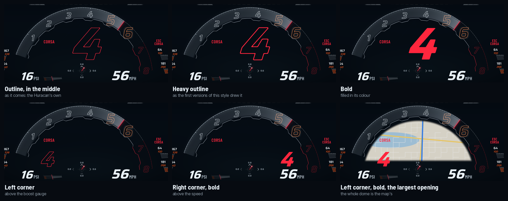
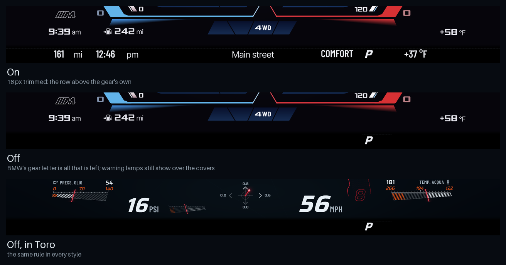

# mgu-styles2

MGU Styles: custom instrument clusters for BMW iDrive 7 (MGU), an app by **#tunedbywali**.
Three styles you switch between on iDrive:

- **Toro** — after a modern Lamborghini: a wide rev band, a big gear
  numeral (outline, heavy or bold; in the middle or in a corner), wedge
  gauges, boost, a G meter, shift lights, three backgrounds.
- **M Sport** — BMW M's iDrive 8 M View, rebuilt for the iDrive 7 panel.
- **M Sport Plus** — the same dials round the M stripes, with a wide
  picture in the middle.

Each can show the phone's map, BMW's own map or Turn View's camera in its
middle, and each has its own settings on the app's page.

> **Unofficial. Nothing to do with BMW AG or Automobili Lamborghini.**
> Changing what your cluster shows can distract you and may affect your
> warranty. The car's own warning lights and its gear display are never
> covered. Test it parked. You use it entirely at your own risk.

This is version **0.9.2**. What changed in each version is in
[CHANGELOG.md](CHANGELOG.md).

## What you need

- A BMW with iDrive 7 (MGU) and a rooted head unit.
- The [MGU Store](https://github.com/robertnisipeanu/mgu-store), with
  `cluster-render` working.
- Developed on a 2023 X3 M40i. Other cars may differ: see *Tell me how it
  goes*.

## Installing

1. In the MGU Store, add this repository as a source.
2. Install **mgu-styles2**.
3. Open it from iDrive's menu. It is **off** after install: nothing on
   your cluster changes until you press the switch on the **CLUSTER** tab.

To get BMW's own cluster back at any time: the same switch. A key-off
hands it back too, and a head-unit restart always does.

For a map or the camera in the middle, set the car's *Instrument cluster >
Central display area* to *Map view*.

## Settings, in short

Everything is set on the app's page on iDrive — nothing on the cluster.

- **GENERAL**: on / off, start with the car, the style, units, your car,
  redline and limiter, the limiter flash, BMW's bottom strip (show, trim
  or hide it), readings with or without BeeM-Flash, **electric range** for
  plug-in hybrids and electric cars (off until you turn it on), the
  holiday theme, the start-up message.
- **TORO / M SPORT / M SPORT PLUS**: each style's own — what its middle
  shows and how much of it, colours, the gear, the footer's readings.

(The pictures are the app's own preview, not photographs of a car.)

## If a black box appears in the rev dial

BMW's cluster draws one when its gear letter is covered. MGU Styles never
covers it, but if you see one after choosing *BMW's bottom strip → Hide
it*: choose *Hide it, a wider gap left beside the gear*, lock the car and
let it sleep once — and please report it.

## Tell me how it goes

Feedback is what this release is for. Open an **issue** on this repository
with your car, what you set, what you saw — and a photograph of the
cluster if you can. [docs/IN-CAR-TEST.md](docs/IN-CAR-TEST.md) lists what
is most useful to check.

## Licence

**MGU Styles is currently free, and open for public testing, without its
source code.** You may install the app, unmodified, on your own car and
use it for yourself, and send feedback. You may not copy, modify, decompile for reuse, redistribute
or sell it, or use any part of it in something else. The terms are in
[LICENSE](LICENSE).

Parts that are other people's keep their own licences: the MGU App Kit in
`kit/` (MIT), `cluster_render_client.js` (MPL 2.0) and the typefaces
(SIL OFL 1.1) — see `apps/mgustyles_toro/NOTICE`.

## Credits

MGU Styles stands on what others built and worked out, mostly on their
own cars. Thank you to:

- **Robert Nisipeanu** —
  [robertnisipeanu/idrive-apps](https://github.com/robertnisipeanu/idrive-apps):
  `cluster-render`, the renderer every cluster app draws through, and its
  protocol; *Maps on cluster*, which puts the phone's map on the cluster;
  and the [MGU Store](https://github.com/robertnisipeanu/mgu-store), which
  installs all of it.
- **[ALMSTRA/idv7lol](https://github.com/ALMSTRA/idv7lol)** — the rule that
  a cluster theme ends above BMW's bottom strip, the shader limits, boost
  readings, and the copy of the MGU App Kit used here.
- **[cauliflowermossgrape/idrive7-apps](https://github.com/cauliflowermossgrape/idrive7-apps)**
  — the **MGU App Kit** (MIT) that runs and packages the app, and the
  engine readings' identifiers.
- **[Vizualyse/idrive-apps](https://github.com/Vizualyse/idrive-apps)** — the
  measurements of the cluster's panel: that only the gear's window in
  BMW's strip must stay uncovered, the glass's cut corners, where the
  warning lamps stand.
- **[IterioDev/car-apps](https://github.com/IterioDev/car-apps)** — Turn
  View, whose front camera and next turn can show in the middle (used as
  installed; nothing of it is in this app).
- **[bimmer-lab/apps](https://github.com/bimmer-lab/apps)** — a map inside
  a cluster theme, and where BMW's map sits on the panel.
- **[ZEKAI-Design/ID7-Cluster-Themes](https://github.com/ZEKAI-Design/ID7-Cluster-Themes)**
  and **[NamelsMissing/mgu-apps](https://github.com/NamelsMissing/mgu-apps)**
  — app structure, signal catalogues and layout practice.
- The typefaces: **Saira**, **Chakra Petch**, **Michroma**, **Barlow
  Condensed**, **Barlow Semi Condensed** and **Inter Tight** (SIL Open Font
  License 1.1).

None of them is responsible for this app, and none endorses it.
