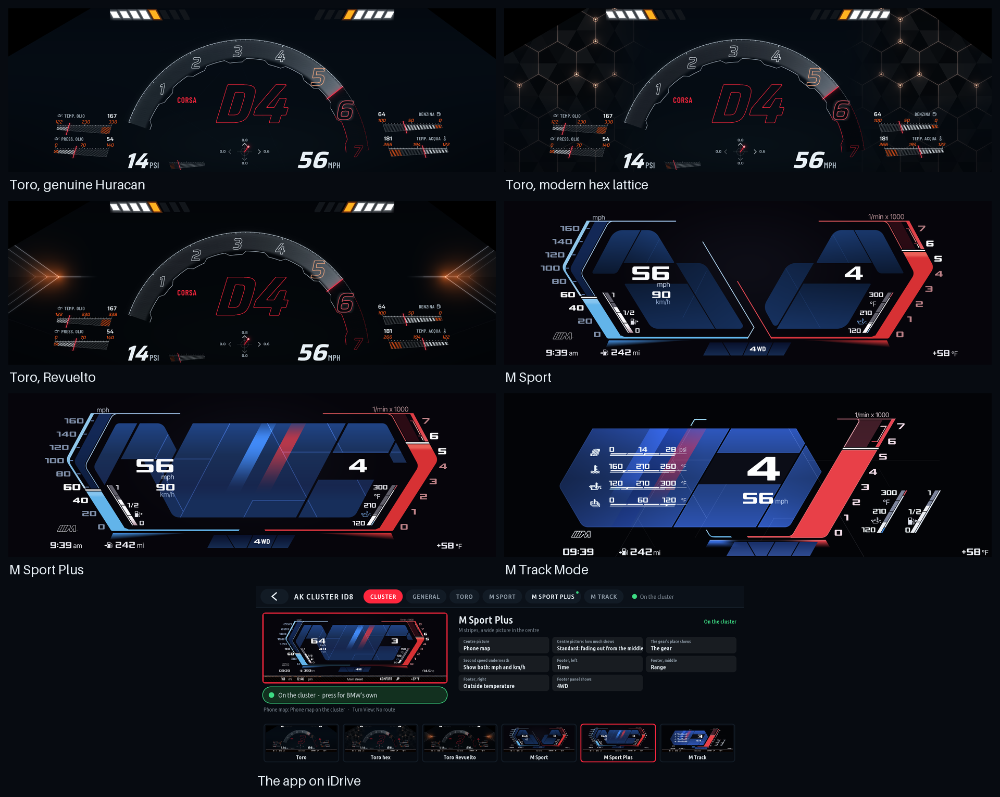
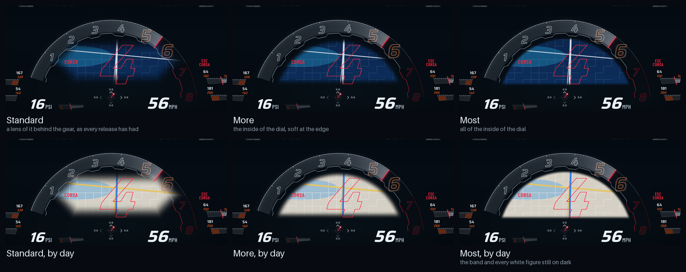
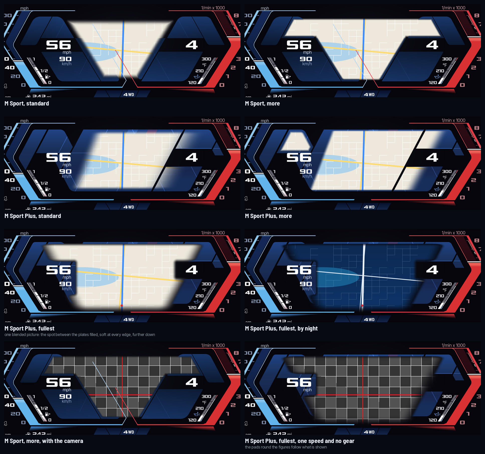
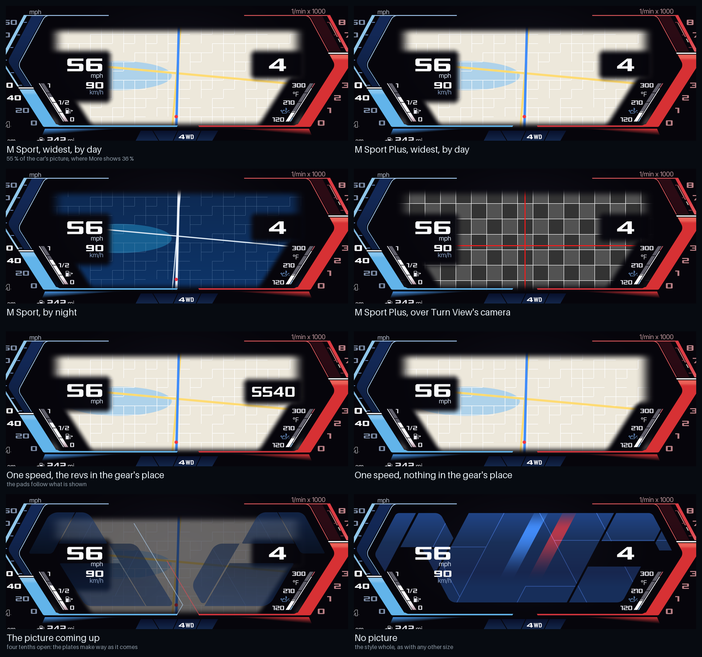
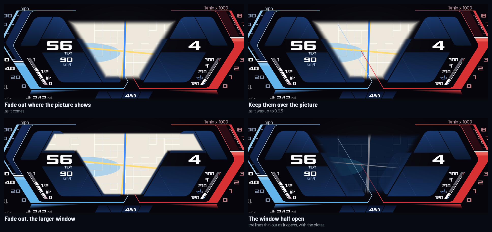
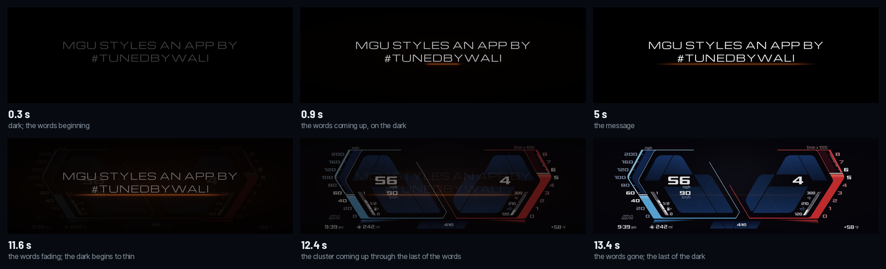
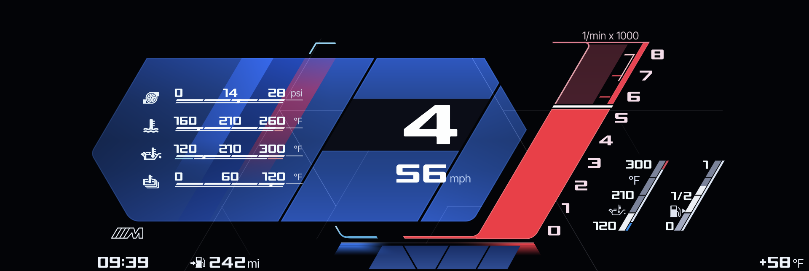
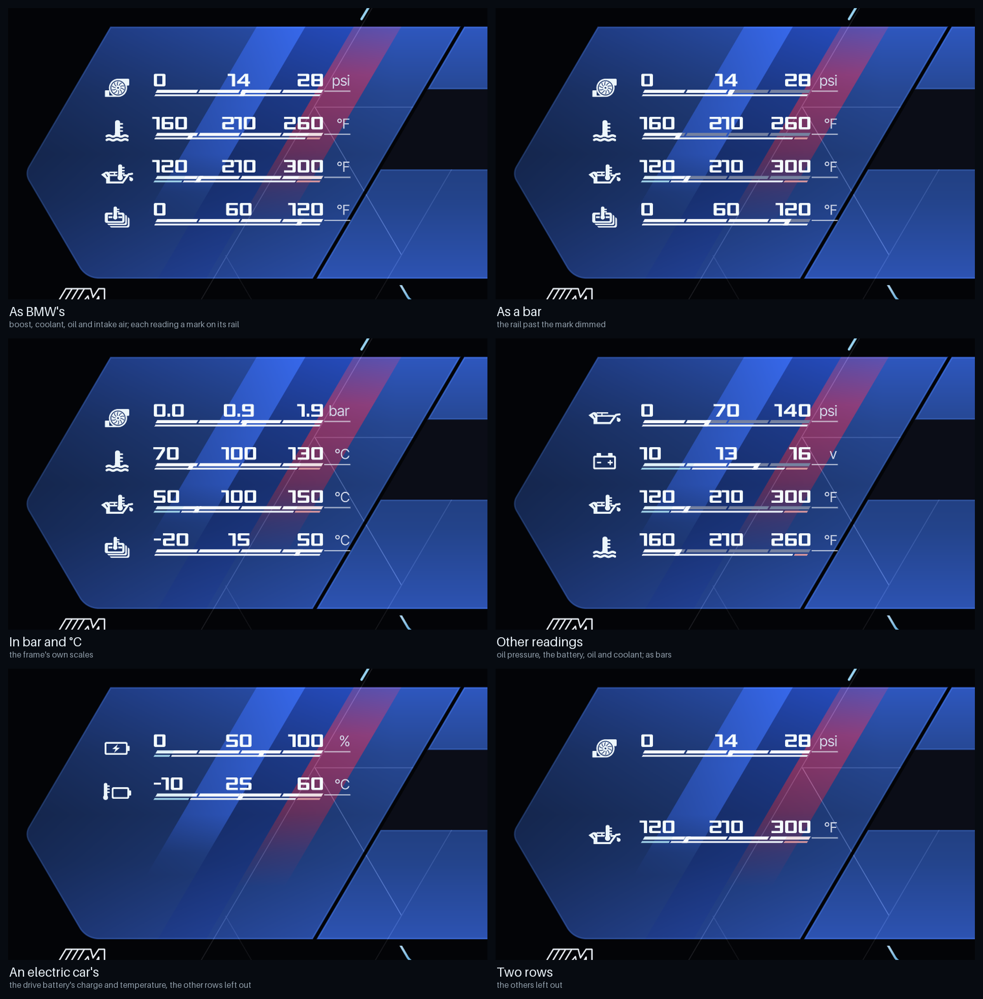
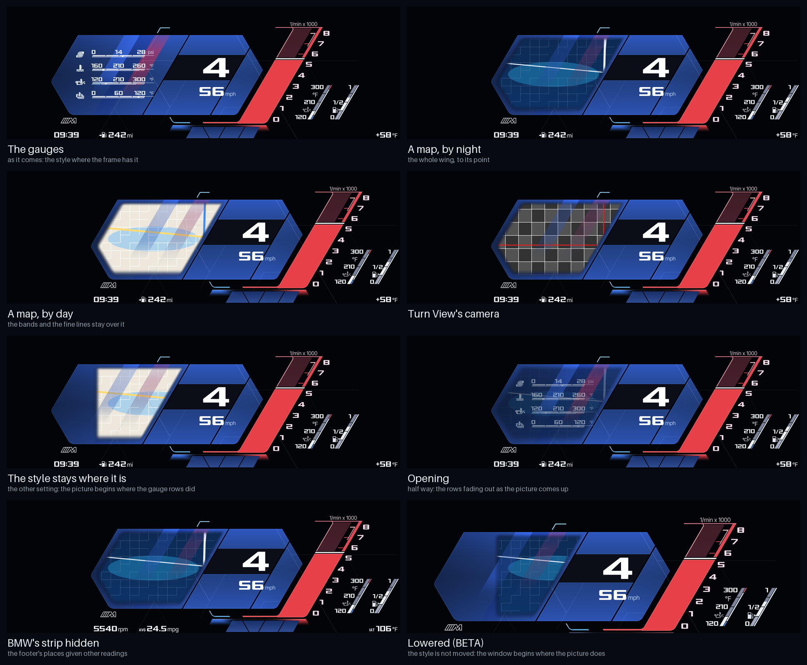
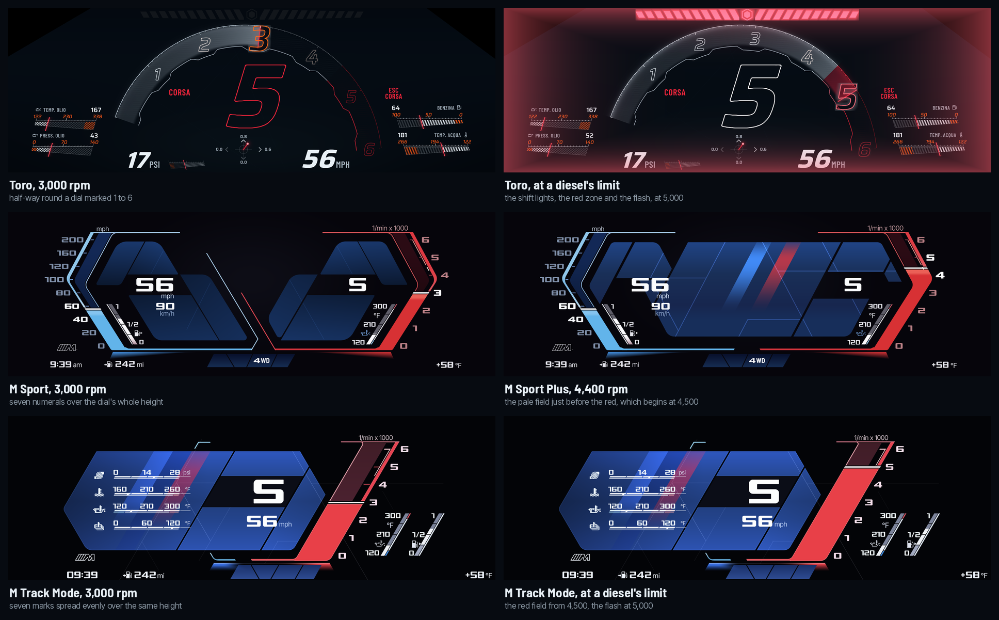

> **보관 기록:** 2026-11-23 저작자 waliworld의 개인 테스트용으로 보관하는 MGU-Styles2 사본입니다. 라이선스는 저작자가 수정해 준 LICENSE를 따릅니다. 
>
> **AK Cluster ID8 (배포 `main`, 작업 `test`):** 2026-11-23 저작자 waliworld가 개인·비상업 용도의 사용·수정·빌드·설치를 허락했습니다
> (LICENSE 1.c-e, 3). `apps/akakingj_cluster_id8`이 그 개인 수정판이고, `mgu-repo.json`이 그 앱
> 하나를 Store에 내놓습니다. 원본 MGU Styles와 따로 설치되는 앱이고(원본은 저작자 저장소에 있습니다), 저작권 고지(LICENSE, `app/NOTICE`)는
> 그대로 둡니다. 공개 저장소·공개 Store 카탈로그에 올리거나 남에게 주지 않습니다.
> 원본 0.10.0의 소스(`src/`, `app/`, `test/`, `tools/`)에서 `node tools/stage-app.js`로 `apps/akakingj_cluster_id8`을 만들고,
> `node --test test/*.test.js`로 검사합니다. 디자인 그림이 바뀌면 `python3 tools/make-previews.py`로 페이지의 미리보기를
> 다시 굽습니다. 바뀐 것은 `CHANGELOG.md` 맨 위 "AK" 항목에 있습니다.

# mgu-styles2

MGU Styles: custom instrument clusters for BMW iDrive 7 (MGU), an app by **#tunedbywali**.
Four styles you switch between on iDrive:

- **Toro** — after a modern Lamborghini: a wide rev band, a big gear
  numeral (outline, heavy or bold; in the middle or in a corner), wedge
  gauges, boost, a G meter, shift lights, three backgrounds.
- **M Sport** — BMW M's iDrive 8 M View, rebuilt for the iDrive 7 panel.
- **M Sport Plus** — the same dials round the M stripes, with a wide
  picture in the middle.
- **M Track Mode** — BMW M's track view, rebuilt the same way: four gauge
  rows of your choosing in a blue wing, the gear large beside them, a
  leaning red rev counter. **New in this version and not yet driven**:
  see *M Track Mode*, below.

Each can show the phone's map, BMW's own map or Turn View's camera — in
its middle, or in M Track Mode's left wing — and each has its own settings
on the app's page.



> **Unofficial. Nothing to do with BMW AG or Automobili Lamborghini.**
> Changing what your cluster shows can distract you and may affect your
> warranty. The car's own warning lights and its gear display are never
> covered. Test it parked. You use it entirely at your own risk.

This is version **0.10.0**. What changed in each version is in
[CHANGELOG.md](CHANGELOG.md).

**Would you rather have the stable beta?** This version adds a good deal
that has not been on a car yet. The release before it, **0.9.6**, has: it
is kept on this repository's **`beta-6`** branch. In the MGU Store, add
this repository as a source and choose **beta-6** where it asks what to
follow; **main** is this version.

## What you need

- A BMW with iDrive 7 (MGU) and a rooted head unit.
- The [MGU Store](https://github.com/robertnisipeanu/mgu-store), with
  `cluster-render` working.
- Developed on a 2023 X3 M40i (petrol). Other cars may differ: see *Tell
  me how it goes*. **A diesel?** See *If your car is a diesel*, below.

## Installing

1. In the MGU Store, choose *Add source* and type exactly:

   ```
   waliworld/MGU-Styles2
   ```

   That is all: no `https://`, no spaces, a hyphen (not an underscore),
   and the **2** on the end. Capitals do not matter. The Store checks the
   repository and asks what to follow: choose the branch **main** for
   this version (**beta-6** is the stable beta, 0.9.6).
2. Install **mgu-styles2**.
3. Open it from iDrive's menu. It is **off** after install: nothing on
   your cluster changes until you press **Show on the cluster** in its bar.

**If the Store will not add it**, its status line says why:

| It says | What it means | What to do |
|---|---|---|
| `Not owner/repo or https://host/path` | What was typed is not a repository's name | Type it again exactly as above |
| `Not found or private` | No such public repository: nearly always a typing slip, most often the **2** left off the end | Type it again exactly as above. Do not sign in or add a token: none is needed |
| `GitHub limit reached. Try later or sign in.` | GitHub allows only so many unsigned requests an hour from one internet connection (a phone hotspot shares its with others) | Wait an hour, or use *Sign in with GitHub* in the Store |
| `Add source failed: Offline` | The head unit has no internet | Connect it (hotspot or the Store's uplink) and try again |
| `... is already a source` | It was added before | Nothing: look for **mgu-styles2** in the Store's list |

If you added an earlier address for this app (`waliworld/MGU-Styles`,
without the 2), remove that source: it is no longer public.

To get BMW's own cluster back at any time: the same switch. A key-off
hands it back too, and a head-unit restart always does.

For a map or the camera in the middle, set the car's *Instrument cluster >
Central display area* to *Map view*.

## Settings, in short

Everything is set in the app on iDrive — nothing on the cluster. Its page
(as AK Cluster Layouts'): the style on the cluster, what each of its places
shows, and a card for each design to tap. Its bar: **Show on the cluster**,
**Logs** and **Settings**. Settings goes a step at a time, as the head
unit's own: *Show on the cluster* (*On* or *Off (stock cluster)*, kept
from one start to the next) and the style at the top, then the same sections as AK Cluster Layouts' Settings, in its
order and with its names, then the style in use's own (**Toro**, **M Sport**, **M Sport Plus** or **M Track**; another
style's appear once it is chosen).

- **Display**: **Style in Sport** and **Style in ECO PRO** (as Layouts' *Layout in Sport* / *in ECO PRO*: a design
  of its own for every Sport mode - Sport+, Individual, a plug-in hybrid's Sport and XtraBoost - and for ECO PRO and a
  plug-in hybrid's Electric, or *Same as Style*; the cluster changes once the mode has held 1.5 s, and in that mode a
  card on the page picks that mode's design), BMW's bottom strip (on or off) and under it *set it yourself* - the
  cluster lowered and enlarged: 20 px and 3 %, 40 px and 6 %, 58 px and 9 % (as far as Toro goes) or 74 px and 11 %,
  BMW's strip hidden - the speed limit sign's edge, the refresh
  rate and the needles between the car's updates, the holiday theme, the start-up message, the skin.
- **Start-up words** (the last row of Settings): the start-up message in your own words, typed on the head unit's own
  keyboard, Korean on a Korean car; OK makes them the message (*Your own words*). Letters the message's face has not,
  Korean among them, come from the head unit's own Korean font (a Korean package's).
- **Readouts and gauges**: **Toro: G meter size** (the g its edge stands for: 1.0 - 2.0), **Speedometer up to** (260
  km/h, 330 for an M car), **Oil / Coolant / Gearbox is too hot at** (where Toro's gauges, M Track Mode's rows and M
  Sport's oil strip turn red; the oil blue until *Oil is warm at*) and **Boost gauge up to** (bar or psi, as the units).
  Toro's G meter's dot moves as the driver feels the load: to the right in a left bend, up braking, down accelerating.
- **Red zone and shift**: **Yellow light at** (where the shift lights begin), **Red light at (the red zone)**, **Shift
  now warning at** (past the shift point the shift lights flash and the speed and the gear blink red, in every style),
  **Gauge goes up to**, **Engine's top rpm (redline)**, the limiter flash, and the **cold engine** guard (the shift
  point and the red zone lower while the oil is cold).
- **Units and clock**: the units (fuel economy: km/L, L/100km, mpg (US) or mpg (UK)) and the clock (the car's own
  time).
- **Car**: **Engine** - *Auto (from the car)*, *Diesel*, *Petrol*, *Petrol, M car* (the layers keep clear of its M
  display's boxes) or *Plug-in hybrid (petrol)*, as Cluster Layouts' and the Car profile's. A plug-in hybrid (chosen,
  or on *Auto* once the car shows it is one: its drive modes, or eDrive Live sharing its battery's power, as Cluster
  Layouts finds one) gets its electric range beside the fuel's and its eDrive box kept clear; in its electric and
  hybrid modes every style's rev counter becomes a **Power %** gauge as BMW's own: the pedal's demand 0 - 100,
  **CHARGE** in green below 0 while the battery takes the regeneration, from eDrive Live's battery power; the rev
  counter again in SPORT, XTRABOOST and with the lever in S or M. The fuel gauge, as Cluster Layouts': the engine
  unit's own tank level only, its last answer held (0.26.0: no tank size to set). **Electric range when full** (km, in miles with mph): a plug-in hybrid's electric range from its
  charge while the car gives none (shown with "~" before it, as Layouts shows an estimate), and its battery gauge
  against it. The charge is eDrive Live's while it shares one, else the battery unit's own (22 `DDBC`, read only, every
  15 s), as Cluster Layouts takes it (0.29.4: the car's bus signal for it read ~90 % on a car at 39 %, so it is only
  logged).

  What the Car profile app sets (units, clock, engine, the rev figures, the too-hot figures, the G meter, the tank, the
  electric range) is set there for both apps.

AK Cluster Layouts and this app take turns on the cluster: the one that came up first keeps it; the other waits, its
page saying so (*Waiting: AK Cluster Layouts is on the cluster* here, *Waiting: AK Cluster ID8 is on the cluster* on
Layouts').
- **Toro / M Sport / M Sport Plus / M Track**: each style's own — what
  its middle (or M Track Mode's left wing) shows and how much of it,
  colours, the gear (Toro: D1, S1, M1).
  Toro's **Mode name**: the drive mode by Lamborghini's names - *CITTA* (ECO PRO, a plug-in hybrid's Electric and
  Hybrid ECO PRO), *STRADA* (Comfort, Adaptive, a plug-in hybrid's Hybrid), *SPORT*, *CORSA* (Sport+, XtraBoost),
  an Individual its kind's with *EGO* after it (*STRADA EGO*, *CITTA EGO*, *SPORT EGO*), *RECHARGE* (Battery
  Control) - a plug-in hybrid's taking the name of the petrol car's of its kind; or BMW's own, each mode by its own name (*SPORT+*, *SPORT INDIVIDUAL*, *ECO PRO INDIVIDUAL* ...).
- **Logs** (AK 0.17.0): the app's state and logs as QR codes to photograph and send with a problem, three a page
  (Logs again: the next page), and as a file on a USB stick - the same codes as AK Cluster Layouts' Logs (`python3 tools/decode_logs.py
  photo1.jpg photo2.jpg ...` puts them back together).
- **The readings' places are on the page** (AK 0.17.0): the footer's three, Toro's four side gauges, M Track
  Mode's gauge rows and strips — a press on the place lists its readings. They offer the same readings as AK Cluster
  Layouts' places: a footer the rpm, the speed in the other unit, the gear, boost, its target and this drive's peak,
  engine power and this drive's peak, torque, oil temperature and pressure, coolant, gearbox oil, intake air, pedal,
  throttle, ignition timing, the fuel rail's and the supply's pressures, the battery's voltage, the fuel, a drive
  battery's charge, temperature and power, the electric range, the trip computer, the odometer, the 0-60 mph
  (0-100 km/h) time and the last upshift's rpm; a gauge, row or strip any of them that has a scale. The gearbox
  oil is the car's own while it gives one, otherwise the gearbox unit's (as AK Cluster Layouts reads it), asked only
  while it is shown.
  **km/h only** in an M style: *Settings → Units and clock → Speed unit → km/h*, then in the
  style's own settings *Second speed underneath → One speed only* (the M View
  otherwise shows mph and km/h together).






**M Sport Plus** has a third size, *Fullest*: one blended picture across
the middle, soft at every edge and reaching further down, with the speed
and the gear kept on dark ground. Settings → M Sport Plus → *Centre picture: how
much shows*.

**New in 0.10.0 — *Widest*, in M Sport and M Sport Plus.** The car's whole
picture between the two dials, fading out softly at every edge: more than
half of the map, where *More* shows about a third of it. The blue plates
make way for the picture while it shows (and M Sport's two lines with
them), and come back when it goes; the speed, the gear and the fuel and oil
strips each keep a soft patch of dark glass under them, so they read the
same over a bright daytime map. Settings → M Sport or M Sport Plus → *Centre
picture: how much shows → Widest*. It is off until you choose it.



**M Sport's two centre lines no longer cross the map.** Where a picture
shows (the phone's map, BMW's map or the camera) they fade out with the
rest of the window; under it they still run into the rails. To have them
over the picture as before: Settings → M Sport → *Centre picture: the two lines
across it → Keep them over the picture*.



**The start-up message comes up on a dark screen** (Settings → Display: *Start-up
message*, on as it comes). The words fade in, stay for the time you set,
and fade away as the cluster comes up through them. Until 0.10.0 the
cluster could be seen behind the words for about a second just as they
appeared — a slip that had been there from the start, now gone. Nothing
else about it has changed.



## M Track Mode

New in 0.10.0: BMW M's track view, rebuilt for the iDrive 7 panel from a
photograph of it. *Settings → Style → M Track Mode*.



Everything on it is your car's live figures, in the units you chose.

- **Four gauge rows** in the left wing. As they come they are BMW's own
  four: turbo boost, coolant, oil temperature and intake air. On the app's
  page, *Gauge row 1 (top)* … *Gauge row 4 (bottom)* give each
  row another reading — oil pressure, the gearbox oil, battery voltage,
  the accelerator pedal, the throttle, the ignition angle, the engine's
  power or torque, the fuel pressures, the fuel, a drive battery's charge
  or temperature — or leave it out.
- **A row shows its reading as a small mark on its rail.** That is as much
  as the photograph gives away (it was taken with the car idling). If the
  marks are too small to read at a glance: *Gauge rows: the reading shows
  as → A bar*, which dims the rail past the mark.
- **The gear**, large, with the speed under it; **the rev counter** on the
  right, red under its white marker, with the red zone, the limiter flash
  and a diesel's range as in the other styles; **oil temperature and
  fuel** beside it, two strips that take any reading a row can, or the
  fuel (*Strip right of the rev counter, left / right*); and three places
  along the foot that take any reading (*Footer, left / middle / right*).



**A map or the camera in the left wing.** *M TRACK → Left wing shows*: the
four gauges (as it comes), the phone's map (Waze), BMW's own map, or Turn
View's camera. With a picture the four rows make way for it, and it shows
in the wing only: the gear, the speed and the rev counter stay exactly
where they are.

**The picture fills the wing, right to its point.** The car puts its map
in one fixed place on the cluster, and no app can move it — and that place
starts well right of the wing's point. So when you choose a picture the
whole style stands about a tenth of the screen further right (the same
size, at the same height), which lets the picture fill the wing. With the
gauges it stands where it always has. If you would rather it never moved:
*M TRACK → Left wing: how much of it a picture takes → The style stays
where it is* (the picture then starts part way along the wing).

The wing shows the part of the map under it — about a third of the car's
picture, its middle included — not all of it. If the whole map is what you
want while driving, choose M Sport or M Sport Plus with *Widest*.



**It has not been on a car yet** — please say how it goes, above all:
whether the marks on the gauge rows can be read while driving; what the
left wing shows of your map, and whether anything at the screen's right
edge is cut off when a picture is in the wing; and, **on an M car** (M3, M4, X3 M …),
whether one of the boxes those cars draw over any style stands over the
gear.

## If your car is a diesel

As it comes the app is set for a petrol engine: a rev counter to 8,000,
its red zone from 6,750, shift lights and the limiter flash near 7,000 —
which a diesel never reaches, so its revs stay in the bottom half and nothing
lights up. Tell the app it is a diesel:

1. Open the app from iDrive's menu.
2. Press **Settings**, then **Car**.
3. Press **Engine** and choose **Diesel**.

That gives every style a diesel's rev counter:

| | Petrol (as it comes) | Diesel |
|---|---|---|
| The rev counter reads | 0 – 8,000 | **0 – 6,000** |
| Red zone from | 6,750 | **4,500** |
| Limiter flash, last shift light | 7,000 | **5,000** |
| Toro's shift lights begin at | 1,800 below the redline | **3,200** |

If your engine revs higher or lower than that, set **Red light at** and
**Engine's top rpm** in *Red zone and shift* (from 3,000
and 4,000 upwards); *From the car* is the diesel's own figures above.

On a diesel, Toro's lower left gauge shows turbo
pressure, not oil pressure: the app only asks a diesel's engine unit the
standard readings, and there is no standard one for oil pressure.



**This has not been on a diesel car yet** — please say how it goes. If the
rev counter does not move **at all** with *Engine* on *Diesel* (the needle
stays at 0 while the engine runs), that is something else: report it with
your car and model year, and whether the speed and the gear show.

## With the Car profile app

The Car profile app (akakingj/myapp-id7) sets these for every app that follows it, AK Cluster ID8 too. What
it sets is shown here with "Car profile" beside it and changed there:

| Car profile | Here |
|---|---|
| Yellow light at, Red light at, Shift now warning at, Gauge goes up to, Engine's top rpm, the cold engine's three | the same names, *Red zone and shift* (Red light at's *Auto*: *At the limiter* here) |
| Engine | *Car → Engine*, the same five choices |
| The units, the clock | *Units and clock* |
| Speedometer up to, Boost gauge up to | *Readouts and gauges* |
| Skin | *Display* |

## Showing or hiding BMW's bottom strip

BMW's own cluster keeps a strip along the bottom of the screen: range,
clock, street name, driving mode, gear and outside temperature.

1. Open the app from iDrive's menu.
2. Press **Settings**, then **Display**.
3. Press **BMW's bottom strip** and press it.
4. Pick one:

| Choice | What you get |
|---|---|
| **On** (as it comes) | The strip, with 18 px trimmed off its top edge so nothing of BMW's own cluster shows between the style and the strip's figures; over the driving mode only 12 px, so a two-line mode (*ECO PRO* over *INDIVIDUAL*) keeps its first line whole |
| **Off** | Everything in the strip is covered in black except BMW's gear letter |

The change shows on the cluster within about half a second, for every
style. Nothing is set on the cluster itself.

**If the top of BMW's speed limit sign shows under the style** (a small
red arc right of the strip's clock, with Speed Limit Info on): Settings → Display →
**Cover the speed limit sign's edge in BMW's strip**. It covers that spot
alone and leaves the rest of the strip as you have it.

**BMW's gear letter always stays.** It cannot be hidden: if it is covered,
BMW's cluster draws a black box in the rev dial instead. Warning lamps
still show over the covered strip.

With the strip hidden, the M styles' footer can carry what it showed:
the app's page → *Footer, left / middle / right* (time, range,
outside temperature and more), and in Settings → M Sport or M Sport Plus
*The gear's place shows* if you would rather not see the gear twice.
With the electric range on the right, the strip by the rev counter shows the
drive battery's charge (0 - 100 %), as a plug-in hybrid's own cluster has it,
in every M style (unless that strip is set to something else on the page).

M Sport's and M Sport Plus's two strips beside the dials, the fuel and the
oil temperature as they come, take any reading M Track Mode's strips can,
or nothing (the app's page → *Strip by the speedometer (left)*, *Strip by
the rev counter (right)*).


### If a black box appears in the rev dial

It should not: the app never covers the gear letter. If you see one with
*BMW's bottom strip* set to *Off*, set it to *On*, lock the car and let it
sleep once (the box can stay until the cluster restarts) — and please
report it, with your car and model year.

## Is it still as smooth?

It should be exactly as smooth as it was, or a little better. Each style
as it comes asks the head unit for the same as it did in the first public
release — the same number of layers, the same handful of bytes a frame —
and the cluster's GPU now has less to draw: the limiter's red flash is no
longer drawn when nothing is flashing
([docs/PERFORMANCE.md](docs/PERFORMANCE.md) has the measurements). That
was measured on a computer, not in a car, so **if any style feels less
smooth than it did, please say so**, with the style, your settings, and what else the head unit was doing
(navigation, CarPlay, a camera).

## Tell me how it goes

Feedback is what this release is for. Open an **issue** on this repository
with your car, what you set, what you saw — and a photograph of the
cluster if you can. [docs/IN-CAR-TEST.md](docs/IN-CAR-TEST.md) lists what
is most useful to check.

## Licence

**MGU Styles is currently free, and open for public testing, without its
source code.** You may install the app, unmodified, on your own car and
use it for yourself, and send feedback. You may not copy, modify, decompile for reuse, redistribute
or sell it, or use any part of it in something else. The terms are in
[LICENSE](LICENSE).

Parts that are other people's keep their own licences: the MGU App Kit in
`kit/` (MIT), `cluster_render_client.js` (MPL 2.0) and the typefaces
(SIL OFL 1.1) — see `app/NOTICE`.

## Credits

MGU Styles stands on what others built and worked out, mostly on their
own cars. Thank you to:

- **Robert Nisipeanu** —
  [robertnisipeanu/idrive-apps](https://github.com/robertnisipeanu/idrive-apps):
  `cluster-render`, the renderer every cluster app draws through, and its
  protocol; *Maps on cluster*, which puts the phone's map on the cluster;
  and the [MGU Store](https://github.com/robertnisipeanu/mgu-store), which
  installs all of it.
- **[ALMSTRA/idv7lol](https://github.com/ALMSTRA/idv7lol)** — the rule that
  a cluster theme ends above BMW's bottom strip, the shader limits, boost
  readings, and the copy of the MGU App Kit used here.
- **[cauliflowermossgrape/idrive7-apps](https://github.com/cauliflowermossgrape/idrive7-apps)**
  — the **MGU App Kit** (MIT) that runs and packages the app, and the
  engine readings' identifiers.
- **[Vizualyse/idrive-apps](https://github.com/Vizualyse/idrive-apps)** — the
  measurements of the cluster's panel: that only the gear's window in
  BMW's strip must stay uncovered, the glass's cut corners, where the
  warning lamps stand.
- **[IterioDev/car-apps](https://github.com/IterioDev/car-apps)** — Turn
  View, whose front camera and next turn can show in the middle (used as
  installed; nothing of it is in this app).
- **[bimmer-lab/apps](https://github.com/bimmer-lab/apps)** — a map inside
  a cluster theme, and where BMW's map sits on the panel.
- **[ZEKAI-Design/ID7-Cluster-Themes](https://github.com/ZEKAI-Design/ID7-Cluster-Themes)**
  and **[NamelsMissing/mgu-apps](https://github.com/NamelsMissing/mgu-apps)**
  — app structure, signal catalogues and layout practice.
- The typefaces: **Saira**, **Chakra Petch**, **Michroma**, **Barlow
  Condensed**, **Barlow Semi Condensed** and **Inter Tight** (SIL Open Font
  License 1.1).

None of them is responsible for this app, and none endorses it.
